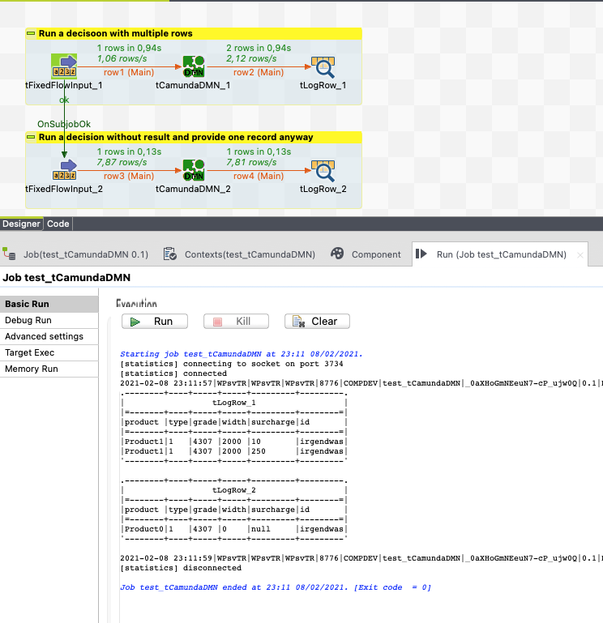

# Talend Component to evaluate DMN rules inside a Talend job
The underlaying API is Camunda DMN. It is Open Source ands freely usable.
At the moment a wrapper class is created and tested to use the Camunda DMN lib as Talend component.
Additional goal in the implementation is to take care misspelling of variables are detected and do not lead to simply null values.

## Processing
The processing is quite simple.
The component expects and input flow containing all input variables from the decision and an output flow containing all output variables of the decision.
You can configure in the component which column will be used for the output.

The component tries to feed the expected input variables of the decision with the incoming flow columns. 
If there are columnbs missing, the component will complain the missing column and fail. 
The component also checks if the expected output can be matched with the output of the decision definition. If a expected output column cannot be matched with a output variable of the decision, the component will fail with a meaningful error message. 

Variables not used for for the output are simply untouched by the component.

To define the decision you can choose a file (xml file with dmn-extension) or you can take the decision from a resource e.g. if you have the decision within a jar file.
You need to know the final decision table id and set this id in the setting decision-key.

## Options
* **Cache parsed decision** (new in 1.6): keeps the parsed decision in a JVM wide cache and reuses it, e.g. if the component runs within an iteration. Default: off.
* **Cache results**: keeps the decision results per combination of input values and reuses them for following rows with the same input values. The cache holds at most 10000 results, the least recently used are removed first.
* **Provide an output record anyway also if the decision has no results**: takes care every incoming record leads to at least one outgoing record. The output columns are null in this case.

## Release notes

### 1.6
* Camunda DMN engine updated from 7.15.0 to 7.24.0. Java 11 is now required.
* The FEEL engine is pinned to 1.19.6. Version 1.19.3, which comes with Camunda 7.24.0, is very slow (it rebuilds its context for every evaluation, see [feel-scala#1108](https://github.com/camunda/feel-scala/pull/1108)).
* New option *Cache parsed decision*.
* Bug fix *Cache results*: different input values could lead to the same cache key and therefore to the result of another row. The cache is now also limited in size.
* **Changed behaviour:** if the decision has no result and *Provide an output record anyway* is set, a not nullable output column now causes an error instead of silently getting null. Set such columns to nullable.
